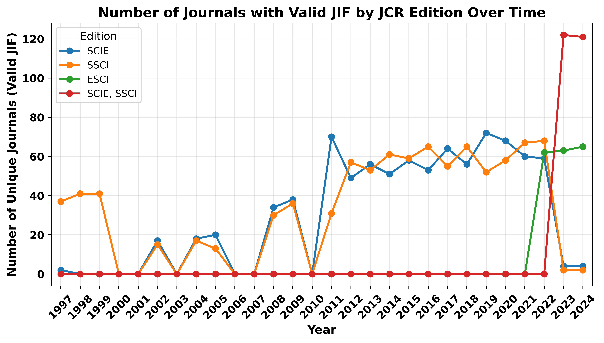
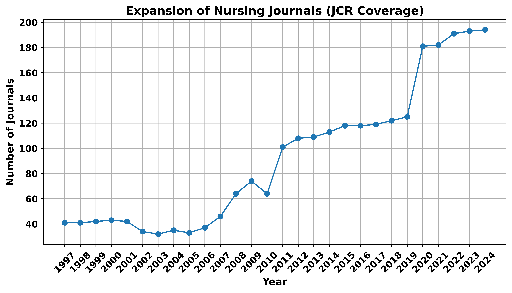
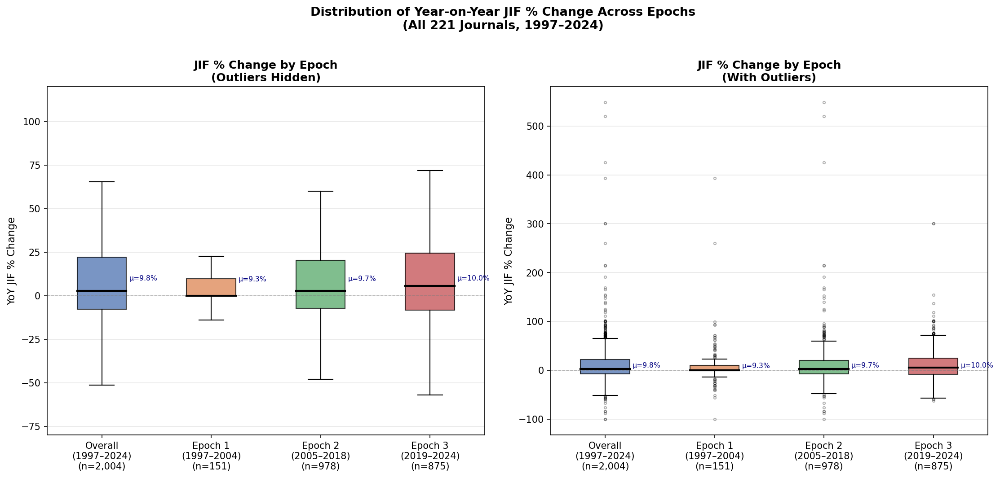

# Journal Impact Factors and the Structure of the Nursing Journal Ecosystem

## 📄 Publication

**Manuscript:** [Journal Impact Factors and the Structure of the Nursing Journal Ecosystem](https://doi.org/10.1016/j.outlook.2026.102904)

**Journal:** *Nursing Outlook*

**Authors:** Leslie H. Nicoll, Mohammed Quazi, Heather Carter-Templeton, Melissa Mastorovich, and Marilyn H. Oermann.

**Publication date:** October 28, 2026

**DOI:** [10.1016/j.outlook.2026.102904](https://doi.org/10.1016/j.outlook.2026.102904)
---

## 📖 Overview

This repository contains the analytic code and dataset structure associated with the manuscript *Journal Impact Factors and the Structure of the Nursing Journal Ecosystem*.

The study examines the longitudinal development of Journal Impact Factors (JIFs) across nursing journals and investigates the structure of the nursing journal ecosystem. Specifically, the analyses characterize changes in JIFs across developmental epochs, examine citation concentration among nursing journals, and describe the distribution of journals and citations across major publishers.

The analyses use Journal Citation Reports (JCR) data from Clarivate, covering the period 1997–2024.

## 🗃️ Data Availability

The Journal Impact Factor data analyzed in this study were obtained from the Journal Citation Reports (Clarivate Analytics) and are subject to Clarivate’s licensing and copyright restrictions; accordingly, the underlying JCR data cannot be publicly shared by the authors. The analytic code and dataset structure are available in this public GitHub repository.

Researchers with authorized access to the Journal Citation Reports may use this code to reproduce the analyses described in this article.

## 📁 Repository Contents

The repository contains the analytical code and dataset structure used in the study. The underlying proprietary JCR data are not included.

## 📊 Figures

### Figure 1. Number of nursing journals with valid Journal Impact Factors over time

Number of unique nursing journals with a reported Journal Impact Factor (JIF) greater than zero for each available Journal Citation Reports (JCR) edition. Missing and zero JIF values were excluded.

### Figure 2. Longitudinal trend in the number of nursing journals with valid Journal Impact Factors

The number of nursing journals with valid Journal Impact Factors (JIFs) increased over time, with gradual growth during earlier years followed by a marked increase in the most recent period. The figure includes 192 journals with valid JIF observations; missing years are not displayed.

### Figure 3. Distribution of year-over-year Journal Impact Factor (JIF) percent change across three epochs

Boxplots show the distribution of year-over-year percent change in JIF during 1997–2004, 2005–2018, and 2019–2024. Boxes represent the interquartile range (IQR), horizontal lines indicate the median, whiskers extend to 1.5 × IQR, and mean values (μ) are shown. The left panel provides an expanded view of the central distribution; the right panel displays the complete range of observations, including outliers.

---

## 📋 Tables

### Table 1. Distribution of Journal Impact Factor (JIF) Change Across Developmental Epochs

| Measure | Overall (1997–2024) | Epoch 1 (1997–2004) | Epoch 2 (2005–2018) | Epoch 3 (2019–2024) |
|:---|---:|---:|---:|---:|
| Number of journals (*n*) | 221 | 49 | 130 | 199 |
| Mean JIF change | 9.8% | 9.3% | 9.7% | 10.0% |
| Median JIF change | 2.7% | 0.0% | 2.7% | 5.6% |
| Standard deviation | 37.0% | 46.5% | 40.4% | 30.7% |
| Minimum | −100.0% | −100.0% | −100.0% | −62.5% |
| Maximum | 548.1% | 393.3% | 548.1% | 300.0% |
| 25th percentile (Q1) | −7.7% | 0.0% | −7.3% | −8.4% |
| 75th percentile (Q3) | 22.0% | 9.6% | 20.3% | 24.3% |

### Table 2. Citation Concentration Among Nursing Journals (*n* = 221)

| Journal Group | Number of Journals | % of Total Journals | % of Total Citations |
|:---|---:|---:|---:|
| Top 10% | 23 | 10.4 | 29.0 |
| Top 25% | 56 | 25.3 | 55.9 |
| Top 50% | 111 | 50.2 | 85.8 |
| Remaining Journals | 110 | 49.8 | 14.2 |
| **Total** | **221** | **100.0** | **100.0** |

### Table 3. Distribution of Nursing Journals and Citations by Publisher

| Publisher | Number of Journals | % of Journals | % of Total Citations |
|:---|---:|---:|---:|
| Wolters Kluwer (including Lippincott Williams & Wilkins) | 33 | 14.9 | 24.4 |
| Wiley (including Wiley-Blackwell) | 78 | 35.3 | 14.0 |
| Elsevier (all imprints) | 50 | 22.6 | 20.0 |
| Sage | 19 | 8.6 | 10.7 |
| Other publishers | 41 | 18.6 | 30.9 |
| **Total** | **221** | **100.0** | **100.0** |

---

## 🔁 Reproducibility

The analytic code is provided to support transparency and reproducibility of the statistical analyses and visualizations reported in the manuscript.

Researchers wishing to reproduce the analyses should:

1. Obtain authorized access to the relevant Journal Citation Reports data from Clarivate.
2. Prepare the dataset according to the dataset structure used in this repository.
3. Run the corresponding analytical scripts.

The original proprietary JCR data are not included in this repository and must be obtained independently through an authorized source.

## 📚 Citation

If you use this repository or refer to the findings of this study, please cite the original publication:

Nicoll, L. H., Quazi, M., Carter-Templeton, H., Mastorovich, M., & Oermann, M. H. (2026). Journal impact factors and the structure of the nursing journal ecosystem. *Nursing Outlook*. https://doi.org/10.1016/j.outlook.2026.102904
